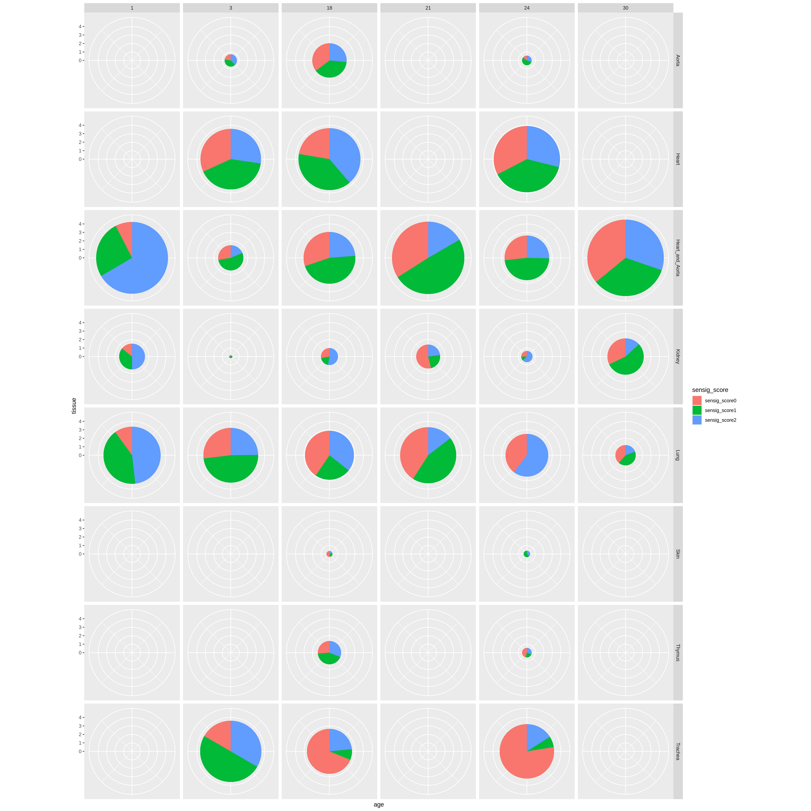
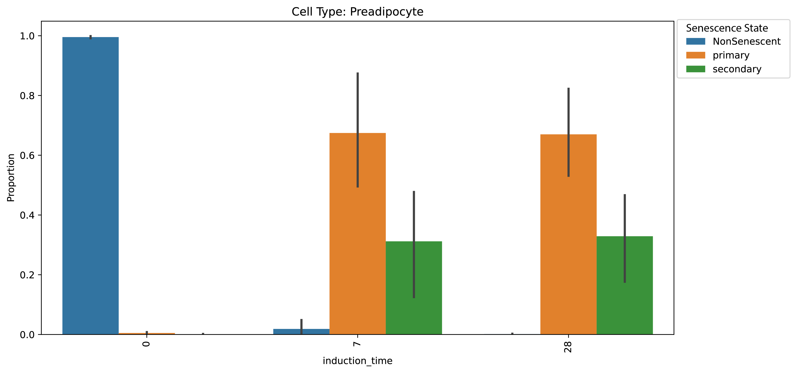

# SENTRY

[](https://github.com/nerettilab/SENTRY/actions/workflows/ci.yml)
[](https://www.nextflow.io/)
[](https://docs.conda.io/en/latest/)
[](LICENSE)

## Introduction

**SENTRY (SENescence TRacking sYstem)** is a Nextflow pipeline for analyzing single-cell RNA
sequencing (scRNA-seq) data with machine learning classifiers. It labels every cell using any
combination of:

- **ML model predictions**, including the pretrained SENTRY classifiers for senescent vs.
  non-senescent cells and for primary vs. secondary senescence ([`models/`](models/README.md)),
  or your own scikit-learn models. Models can be chained, so one model's output can filter or
  refine another's.
- **Gene expression**: above/below a threshold, or binned into levels.
- **Cell cycle phase**, scored with the Tirosh et al. (2016) gene lists.
- **Senescence signature scores** (SenSig) computed from a differential expression table.

It then summarizes how these labels are distributed across two metadata variables, for example
age and cell type, and draws pie and bar charts for every combination. Human and mouse data are
supported; genes are converted between the two species through one-to-one orthologs where a
model needs it.

## Pipeline overview

1. **Convert** Seurat objects to AnnData, if `--seurat_input` is set.
2. **Preprocess** (`PREPROCESS_ADATA`): apply every criterion in the threshold combinations
   file to each sample and save the cell labels as a table.
3. **Group** (`GROUP_ANALYSIS_COMBINATIONS`): count cells and compute proportions for each
   `column1` × `column2` group, and per sample if `--sample_column` is given.
4. **Plot** (`CREATE_PIES`, `CREATE_BARS`): one pie chart grid and a set of bar charts per
   combination.

## Quick start

1. Install [Nextflow](https://www.nextflow.io/docs/latest/install.html) (≥ 23.04.0) and
   [conda](https://conda-forge.org/download/).

2. Check that everything works on the bundled synthetic test data:

   ```bash
   nextflow run nerettilab/SENTRY -profile test,conda --outdir test_results
   ```

3. Run on your own data:

   ```bash
   nextflow run nerettilab/SENTRY \
      -profile conda \
      --input samplesheet.csv \
      --threshold_combinations threshold_combinations.json \
      --column1 age \
      --column2 cell_type \
      --outdir results
   ```

> [!NOTE]
> Software is provided through conda environments (`-profile conda` or `-profile mamba`).
> The pipeline does not yet ship container images, so `-profile docker` and
> `-profile singularity` do not provide the required software.

## Inputs

### Samplesheet

A CSV file with one row per AnnData (`.h5ad`) or Seurat (`.rds`) object. Relative paths are
resolved from the folder that contains the samplesheet.

```csv
sample,sc_object
young_lung,/data/young_lung.h5ad
old_lung,/data/old_lung.h5ad
```

The pipeline expects **raw counts**. If `adata.X` holds normalized values, point the pipeline
at the counts with `--use_raw` or `--layer_name`.

### Threshold combinations

A JSON file that defines named criteria and lists the combinations to analyze. Each
combination produces one label per cell, made by joining the labels of its criteria with `_`.
Relative paths in the file are resolved from the file's own folder.

This example uses both SENTRY models. The second combination reports primary vs. secondary
senescence only for cells that the first model calls senescent:

```json
{
  "definitions": {
    "senescence": {
      "type": "model",
      "path": "/path/to/SENTRY/models/sentry_senescent_vs_nonsenescent_rf.pkl",
      "taxon": 9606
    },
    "senescent_only": {
      "type": "model_select",
      "path": "/path/to/SENTRY/models/sentry_senescent_vs_nonsenescent_rf.pkl",
      "taxon": 9606,
      "keep_classes": ["Senescent"]
    },
    "senescence_type": {
      "type": "model",
      "path": "/path/to/SENTRY/models/sentry_primary_vs_secondary_rf.pkl",
      "taxon": 9606
    },
    "cell_cycle": { "type": "cell_cycle" },
    "CDKN1A": { "type": "gene", "threshold": 2 }
  },
  "combinations": [
    ["senescence"],
    ["senescent_only", "senescence_type"],
    ["senescence", "cell_cycle"],
    ["CDKN1A", "senescence"]
  ]
}
```

The criterion types are `model`, `model_select`, `gene`, `bins`, `cell_cycle`, `sensig_score`
and `comparative_score`. See [docs/usage.md](docs/usage.md) for every option, and
[`assets/test/threshold_combinations.json`](assets/test/threshold_combinations.json) for a
working example.

### Main parameters

| Parameter | Description |
| --- | --- |
| `--input` | Samplesheet CSV (required). |
| `--outdir` | Output directory (required). |
| `--threshold_combinations` | Criteria and combinations JSON (required). |
| `--column1` | `adata.obs` column for the first grouping level, e.g. `age` (required). |
| `--column2` | `adata.obs` column for the second grouping level, e.g. `cell_type` (required). |
| `--sample_column` | `adata.obs` column identifying samples or replicates; adds per-sample proportions and error bars. |
| `--sample_taxon` | `9606` (human, default) or `10090` (mouse). |
| `--use_raw` / `--layer_name` | Read counts from `adata.raw` or from a layer instead of `adata.X`. |
| `--var_colname` | `adata.var` column with gene symbols, if `var_names` are not symbols. |
| `--seurat_input` | Inputs are Seurat `.rds` files. |
| `--save_h5ad` | Also save each annotated AnnData object. |
| `--uns_name` | Prefix for output file names (default `analyzed_data`). |

Run `nextflow run nerettilab/SENTRY --help` for the full list.

## Outputs

```
results/
├── preprocessed/   <prefix>_<sample>_processed_data.tsv.gz   cell metadata plus one column per combination
├── group/          <prefix>_<sample>_<combination>_gene_combinations[_with_sample].tsv
├── pie_charts/     <prefix>_<sample>_<combination>_pie.png
├── bar_charts/     <prefix>_<sample>_<column2 value>_<combination>_bar_chart.svg
├── multiqc/        run report with parameters and software versions
└── pipeline_info/  Nextflow execution report, timeline, trace and DAG
```

See [docs/output.md](docs/output.md) for the columns of each table and how to read the charts.

<p align="center">
  
  
</p>

_Left: senescence score levels across organs and ages. Right: primary vs. secondary
senescent preadipocytes over time._

## Citation

If you use SENTRY in your research, please cite:

> Hinthorn S, Rocha A, Neretti N. SENTRY: An AI Framework for Identifying and Characterizing
> Primary and Secondary Senescence. _(in preparation)_

The single-cell RNA-seq data generated for the study are available from GEO under accession
[GSE306635](https://www.ncbi.nlm.nih.gov/geo/query/acc.cgi?acc=GSE306635).

[`CITATIONS.md`](CITATIONS.md) lists the tools and resources the pipeline uses. Please cite
them as well.

## Credits

SENTRY was written by Samuel Hinthorn in the [Neretti Lab](https://github.com/nerettilab) at
Brown University.

The pipeline is built on the [nf-core](https://nf-co.re) template and uses code and
infrastructure developed by the nf-core community, reused under the
[MIT license](https://github.com/nf-core/tools/blob/master/LICENSE):

> Ewels PA, Peltzer A, Fillinger S, Patel H, Alneberg J, Wilm A, Garcia MU, Di Tommaso P,
> Nahnsen S. The nf-core framework for community-curated bioinformatics pipelines. _Nat
> Biotechnol._ 2020;38(3):276-278. doi:
> [10.1038/s41587-020-0439-x](https://doi.org/10.1038/s41587-020-0439-x)

## Contributing

Bug reports and pull requests are welcome; see the
[contributing guidelines](.github/CONTRIBUTING.md).
